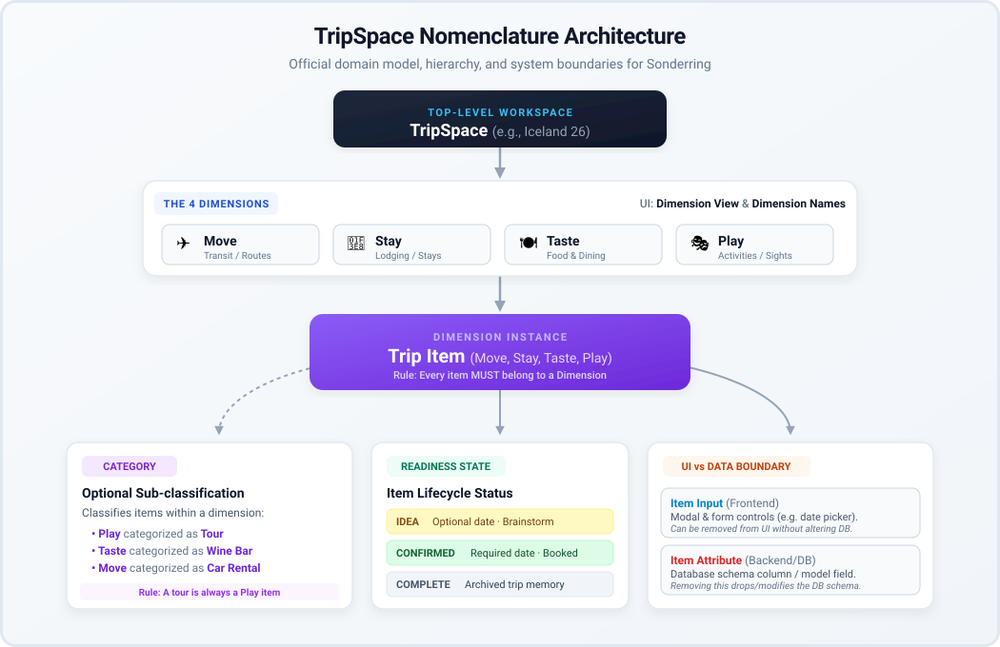
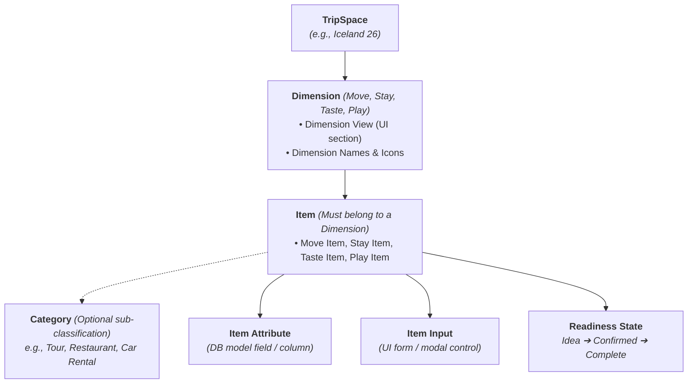

# Sonderring Domain Modeling & TripSpace Nomenclature

This document defines the official terminology, domain hierarchy, and system boundaries for **Sonderring** and its **TripSpaces**. All AI agents, contributors, and developers must follow these conventions across all conversations, design specifications, and codebase implementations.

---

## Nomenclature Architecture Diagram

---

## 1. Foundational Project Pillars

All AI agents, engineers, and contributors must prioritize four critical pillars above all else. They are the non-negotiable foundation of Sonderring:

1. **Authenticity**:
   - **Zero Hallucination Policy**: Never fabricate, synthesize, or invent trip details, venues, flight numbers, confirmation codes, prices, dates, or lodging.
   - **Ground Truth**: Every item must originate from authentic source material (e.g., canonical planning site, verified booking confirmation, user-provided itineraries).
   - If data is absent or ambiguous, keep it minimal or flag it transparently. Do not fill gaps with "plausible" fiction.

2. **Conciseness**:
   - Eliminate marketing fluff, verbose travelogue prose, and flowery adjectives (e.g., replace *"High-elevation mountain parkway drive through rock tunnels with frosty winter vistas..."* with *"Mountain parkway with good views"*).
   - Keep descriptions functional, brief, and essential. Data structures and UI inputs must only capture what travelers actually need.

3. **Standardization**:
   - Uniform terminology across all dimensions (Move, Stay, Taste, Play).
   - Uniform seed file naming: `yy-mm-[trip name].md` (e.g., `21-12-Asheville.md`, `26-08-Hawaii.md`).
   - Standardized field nomenclature:
     - Use **`Location`** everywhere (not `Address` or `Venue`).
     - Use **`Confirmation/Reference`** everywhere (not `Confirmation Code` or `Booking Code`).
     - For **Stay**: Use strictly **`Start Date`** and **`End Date`** (no combined `Dates` string; no `Check-in Time` or `Check-out Time` attributes).
     - For **Move**: Use **`Departure Time`** and **`Arrival Time`** (no direction field).
     - For **Play**: Single **`Date`** with time range (e.g., `Time: 7:30pm – 10:00pm`) when scheduled; price is `Free` (play only), or `$`, `$$`, `$$$`.
     - For **Taste**: Minimalist—no date or time unless bound to a confirmed reservation (`Confirmation/Reference`). Price is `$`, `$$`, `$$$`.
   - Readiness states in seed trip files: strictly **`Status: `CONFIRMED``** or **`Status: `IDEA``** (pre-travel planning). In the live application and database model, **`Status: `COMPLETE``** represents concluded/past items preserved in trip history.
   - **Selective Schema Token Formatting**: Use monospace backticks (`` `...` ``) specifically for controlled database enums (e.g., `Status: `CONFIRMED``, `Status: `IDEA``, `Time Granularity: `EXACT_RANGE``, `Status: `PAST``) and alphanumeric codes/identifiers (e.g., `Flight: `DL 2661``, `Confirmation/Reference: `3208541836``, airport IATA codes `LAX`, `AVL`). Keep dates, times, locations, prices, notes, and descriptions in clean plaintext.

4. **Transparency**:
   - Explicitly document data origins, limitations, and confidence states.
   - Distinctly distinguish between exploratory brainstorming (`Status: Idea`) and verified bookings (`Status: Confirmed`).
   - Track future feature requests, architectural improvements, and backlog tasks openly in [`docs/TASKS.md`](docs/TASKS.md).

---

## 2. Core Terminology Definitions

### 2.1. TripSpace (Level 1)
- **Definition**: The top-level travel canvas and collaborative workspace representing a specific trip or journey (e.g., *Iceland 26*, *Malticilia 26*).
- **Code Entity**: [`Trip`](file:///Users/leilagleich/Desktop/sonderring/core/models.py#L90) model in Django.

### 2.2. Dimension (Level 2)
- **Definition**: One of the four foundational pillars that structure every journey:
  1. ✈️ **Move** — Transit, flights, rail, ferries, driving routes, car rentals.
  2. 🏨 **Stay** — Lodging, hotels, villas, campgrounds, apartments.
  3. 🍽️ **Taste** — Restaurants, cafés, street food, bars, wineries.
  4. 🎭 **Play** — Activities, tours, sights, hikes, performances, museums.
- **Related Terms**:
  - **Dimension View**: The UI column, tab, or section representing that dimension inside a TripSpace workspace (e.g., "the top of the Taste dimension view").
  - **Dimension Names**: The exact titles (`Move`, `Stay`, `Taste`, `Play`) and their primary associated icons/emojis.

### 1.3. Item (Level 3)
- **Definition**: A concrete instance or event created within a dimension for a specific TripSpace (e.g., a *Taste item*, a *Stay item*, a *Move item*, a *Play item*, or collectively *Trip items*).
- **Core Rule**: **Every item must belong to a dimension.** An item cannot exist without a dimension.

### 1.4. Category (Optional Sub-classification)
- **Definition**: An optional category classifying items *within* a specific dimension.
- **Examples**:
  - A Play item categorized as a **Tour**.
  - A Taste item categorized as a **Wine Bar** or **Bakery**.
  - A Move item categorized as a **Car Rental** or **Flight**.
- **Core Rule**: A category is strictly bound to its dimension (e.g., a *Tour* item will always be a *Play* item). Not every item needs to have a category, but every item belongs to a dimension.

---

## 3. UI Controls vs. Database Schema Boundaries

To avoid ambiguity when implementing changes, we strictly distinguish between **Inputs** and **Attributes**:

| Term | Scope | Meaning | Example Directive & Behavior |
| :--- | :--- | :--- | :--- |
| **Item Input** | Frontend (UI) | A form control, text field, date picker, or toggle rendered in a modal or card view. | *"Remove the confirmation input for all trip items"* $\rightarrow$ Hide or remove the `<input>` field from modals and cards. **Do NOT drop or modify the database column.** |
| **Item Attribute** | Backend (Data Schema) | The underlying Django model field or database column. | *"Delete the option for a taste item to have an end date or time"* $\rightarrow$ Remove or nullify the database field / model attribute for Taste items. |

---

## 4. Item Readiness & Lifecycle States

Every item carries a readiness state that determines input validation rules:

1. **`IDEA`**:
   - Exploratory brainstorm or wishlist item.
   - Dates and times are **optional**.
2. **`CONFIRMED`**:
   - Booked or scheduled item.
   - For **Move**, **Taste**, and **Play**: A single `date` is **mandatory**; time is optional.
   - For **Stay**: Check-in (`check_in`) and check-out (`check_out`) dates are **mandatory**.
3. **`COMPLETE`**:
   - Concluded / past item preserved in the TripSpace record and history.

---

## 5. Place / Anchor vs. Trip Item

- **The Place (The Real-World Anchor)**: The physical venue or entity (e.g., *Hotel Grímsborgir*, *Kol Restaurant*). It holds canonical data: name, address, coordinates, website, phone. A Place can be referenced or recommended across multiple TripSpaces.
- **The Item (The TripSpace Occurrence)**: The specific reservation or plan for that Place inside a particular TripSpace. It holds its own UUID (`id`), dates, confirmation codes, assigned travelers, and notes. Even if two TripSpaces reference the same hotel, each TripSpace holds an independent **Stay Item**.

---

## 6. Directive Phrasing Cheat Sheet

When prompts or user stories use these terms, interpret them according to these conventions:

- *"Add a notes section at the top of each dimension view"*:
  $\rightarrow$ Add a UI notes component at the top of all 4 dimension containers (Move, Stay, Taste, Play) on the workspace page.
- *"Remove emojis next to dimension names"*:
  $\rightarrow$ Remove only the 4 primary icons/emojis (✈️, 🏨, 🍽️, 🎭) beside the dimension titles.
- *"Remove the confirmation input for all trip items"*:
  $\rightarrow$ Remove the confirmation number form input from Add/Edit modals across all items; keep the underlying DB column.
- *"Delete the option for a taste item to have an end date or time"*:
  $\rightarrow$ Remove the model attributes (`end_time`, `has_end_time`) for Taste items in the schema and forms.
- *"For play items categorized as a tour, add the attribute length"*:
  $\rightarrow$ Add a `length` field/attribute specifically for Play items whose category is "Tour".

---

## 7. Living User Stories & Acceptance Criteria Protocol

- **Canonical Document**: [`docs/livingUserStoriesAndAcceptanceCriteria.md`](docs/livingUserStoriesAndAcceptanceCriteria.md)
- **Mandatory Agent Rule**: **Always update the Living User Stories & Acceptance Criteria as changes are made in the documents.**
  Whenever modifications, additions, or deprecations are introduced in reference specifications (such as `docs/tripItemAttributesReference.md`), data models, form flows, or domain rules, AI agents and contributors must immediately update `docs/livingUserStoriesAndAcceptanceCriteria.md` to keep user stories and testable acceptance criteria synchronized.

---

## 8. Foundational Documentation Catalog

All agents, developers, and contributors must treat the following documentation suite as the language-agnostic source of truth:

| Document | Purpose | File Link |
| :--- | :--- | :--- |
| **Product Requirements (PRD)** | High-level vision, personas, functional requirements, and non-functional requirements. | [`docs/PRD.md`](docs/PRD.md) |
| **MVP Scope & Roadmap** | Phase 1 (MVP In-Scope) features vs. Phase 2 and Phase 3 roadmaps. | [`docs/MVP.md`](docs/MVP.md) |
| **Cybersecurity Architecture** | AES-256-GCM envelope encryption, Document Vault, RBAC, and STRIDE threat modeling. | [`docs/CYBERSECURITY.md`](docs/CYBERSECURITY.md) |
| **Site Architecture & Flows** | Sitemap, screen inventory, status-first modal flows, and responsive breakpoints. | [`docs/PAGE_OUTLINE.md`](docs/PAGE_OUTLINE.md) |
| **Canonical Data Model** | Entity-relationship diagrams, attribute definitions, state machines, and constraints. | [`docs/DATA_MODEL.md`](docs/DATA_MODEL.md) |
| **API Contract Specification** | RESTful HTTP/JSON endpoints, request/response payloads, and error envelopes. | [`docs/API_SPECIFICATION.md`](docs/API_SPECIFICATION.md) |
| **Markdown Sync Specification** | Canonical grammar, section ordering, and bidirectional sync protocols with `Trips/*.md`. | [`docs/MARKDOWN_SYNC_SPEC.md`](docs/MARKDOWN_SYNC_SPEC.md) |
| **Living User Stories & AC** | Active user stories and testable acceptance criteria synchronized with specifications. | [`docs/livingUserStoriesAndAcceptanceCriteria.md`](docs/livingUserStoriesAndAcceptanceCriteria.md) |
| **Item Attributes Reference** | Field and form input guidelines across all four dimensions. | [`docs/tripItemAttributesReference.md`](docs/tripItemAttributesReference.md) |

