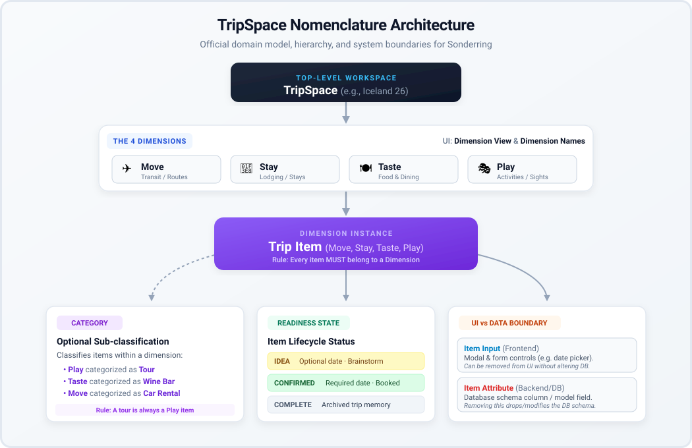
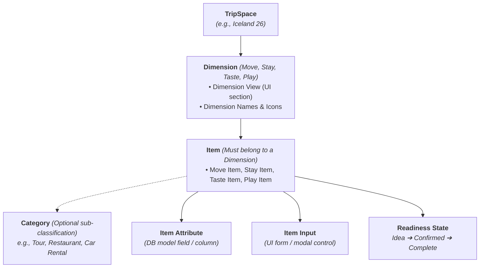

# Sonderring Domain Modeling & TripSpace Nomenclature

This document defines the official terminology, domain hierarchy, and system boundaries for **Sonderring** and its **TripSpaces**. All AI agents, contributors, and developers must follow these conventions across all conversations, design specifications, and codebase implementations.

---

## Nomenclature Architecture Diagram

---

## 1. Core Terminology Definitions

### 1.1. TripSpace (Level 1)
- **Definition**: The top-level travel canvas and collaborative workspace representing a specific trip or journey (e.g., *Iceland 26*, *Malticilia 26*).
- **Code Entity**: [`Trip`](file:///Users/leilagleich/Desktop/sonderring/core/models.py#L90) model in Django.

### 1.2. Dimension (Level 2)
- **Definition**: One of the four foundational pillars that structure every journey:
  1. ✈️ **Move** — Transit, flights, rail, ferries, driving routes, car rentals.
  2. 🏨 **Stay** — Lodging, hotels, villas, campgrounds, apartments.
  3. 🍽️ **Taste** — Restaurants, cafés, street food, bars, wineries.
  4. 🎭 **Play** — Activities, tours, sights, hikes, performances, museums.
- **Related Terms**:
  - **Dimension View**: The UI column, tab, or section representing that dimension inside a TripSpace workspace (e.g., "the top of the Taste dimension view").
  - **Dimension Names**: The exact titles (`Move`, `Stay`, `Taste`, `Play`) and their primary associated icons/emojis.

### 1.3. Item (Level 3)
- **Definition**: A concrete instance or event created within a dimension for a specific TripSpace (e.g., a *Taste item*, a *Stay item*, a *Move item*, a *Play item*, or collectively *Trip items*).
- **Core Rule**: **Every item must belong to a dimension.** An item cannot exist without a dimension.

### 1.4. Category (Optional Sub-classification)
- **Definition**: An optional category classifying items *within* a specific dimension.
- **Examples**:
  - A Play item categorized as a **Tour**.
  - A Taste item categorized as a **Wine Bar** or **Bakery**.
  - A Move item categorized as a **Car Rental** or **Flight**.
- **Core Rule**: A category is strictly bound to its dimension (e.g., a *Tour* item will always be a *Play* item). Not every item needs to have a category, but every item belongs to a dimension.

---

## 2. UI Controls vs. Database Schema Boundaries

To avoid ambiguity when implementing changes, we strictly distinguish between **Inputs** and **Attributes**:

| Term | Scope | Meaning | Example Directive & Behavior |
| :--- | :--- | :--- | :--- |
| **Item Input** | Frontend (UI) | A form control, text field, date picker, or toggle rendered in a modal or card view. | *"Remove the confirmation input for all trip items"* $\rightarrow$ Hide or remove the `<input>` field from modals and cards. **Do NOT drop or modify the database column.** |
| **Item Attribute** | Backend (Data Schema) | The underlying Django model field or database column. | *"Delete the option for a taste item to have an end date or time"* $\rightarrow$ Remove or nullify the database field / model attribute for Taste items. |

---

## 3. Item Readiness & Lifecycle States

Every item carries a readiness state that determines input validation rules:

1. **`IDEA`**:
   - Exploratory brainstorm or wishlist item.
   - Dates and times are **optional**.
2. **`CONFIRMED`**:
   - Booked or scheduled item.
   - For **Move**, **Taste**, and **Play**: A single `date` is **mandatory**; time is optional.
   - For **Stay**: Check-in (`check_in`) and check-out (`check_out`) dates are **mandatory**.
3. **`COMPLETE`**:
   - Concluded / past item preserved in the TripSpace record and history.

---

## 4. Place / Anchor vs. Trip Item

- **The Place (The Real-World Anchor)**: The physical venue or entity (e.g., *Hotel Grímsborgir*, *Kol Restaurant*). It holds canonical data: name, address, coordinates, website, phone. A Place can be referenced or recommended across multiple TripSpaces.
- **The Item (The TripSpace Occurrence)**: The specific reservation or plan for that Place inside a particular TripSpace. It holds its own UUID (`id`), dates, confirmation codes, assigned travelers, and notes. Even if two TripSpaces reference the same hotel, each TripSpace holds an independent **Stay Item**.

---

## 5. Directive Phrasing Cheat Sheet

When prompts or user stories use these terms, interpret them according to these conventions:

- *"Add a notes section at the top of each dimension view"*:
  $\rightarrow$ Add a UI notes component at the top of all 4 dimension containers (Move, Stay, Taste, Play) on the workspace page.
- *"Remove emojis next to dimension names"*:
  $\rightarrow$ Remove only the 4 primary icons/emojis (✈️, 🏨, 🍽️, 🎭) beside the dimension titles.
- *"Remove the confirmation input for all trip items"*:
  $\rightarrow$ Remove the confirmation number form input from Add/Edit modals across all items; keep the underlying DB column.
- *"Delete the option for a taste item to have an end date or time"*:
  $\rightarrow$ Remove the model attributes (`end_time`, `has_end_time`) for Taste items in the schema and forms.
- *"For play items categorized as a tour, add the attribute length"*:
  $\rightarrow$ Add a `length` field/attribute specifically for Play items whose category is "Tour".
