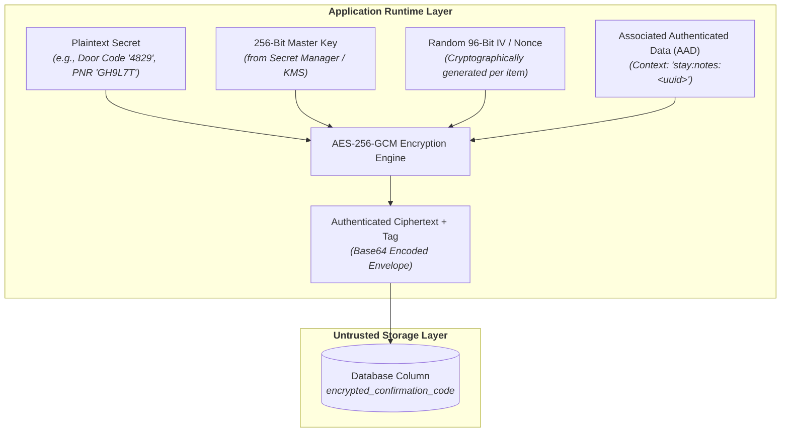
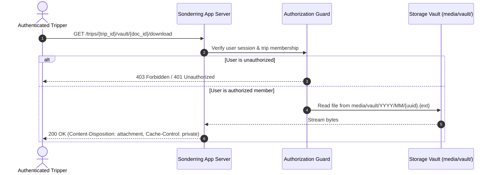
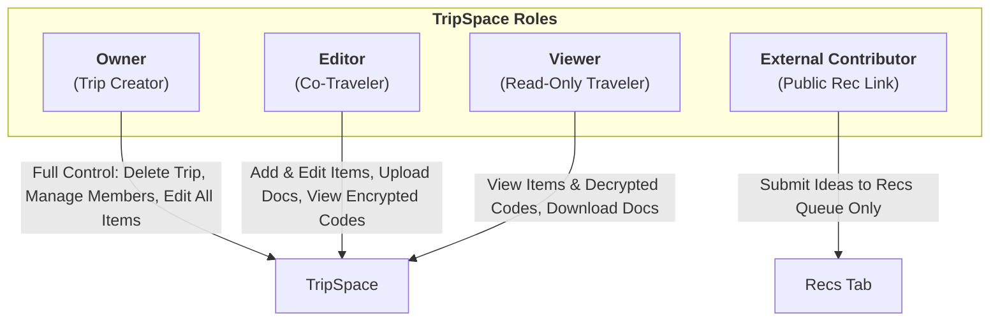

# Cybersecurity Architecture & Threat Model — Sonderring

> **Document Status**: Canonical & Living  
> **Version**: 1.0.0  
> **Classification**: Security Architecture Specification  
> **Implementation Target**: Programming Language & Framework Agnostic  

---

## 1. Executive Summary & Security Philosophy

Travel applications hold uniquely sensitive personal and physical security data. A breach in a travel platform does not just expose email addresses; it reveals:
1. **Physical Vacancy**: Exact dates a user's home will be unoccupied.
2. **Physical Entry Credentials**: Vacation rental lockbox codes, keypad PINs, and smart-lock instructions.
3. **Hijackable Travel Assets**: Airline booking references (PNRs) and passenger surnames, which allow anyone to cancel flights, reassign seats, or reroute itineraries via airline websites without authentication.
4. **Identity Documents**: Passports, driver's licenses, and boarding pass PDFs.

**Sonderring enforces a Zero-Trust Application-Layer Encryption Philosophy**. The database is treated as an untrusted persistence layer. Even in the event of a full database leak or backup exposure, high-value booking credentials and property access codes remain indecipherable ciphertext.

---

## 2. Cryptographic Architecture: AES-256-GCM (AEAD)



### 2.1. Cipher Specification
- **Algorithm**: **AES-256-GCM** (Galois/Counter Mode).
- **Key Length**: 256 bits (32 bytes).
- **Initialization Vector (IV / Nonce)**: Unique 96-bit (12 bytes) cryptographically secure random value generated **for every single encryption operation**. Never reused under the same key.
- **Authentication Tag**: 128-bit (16 bytes) tag computed by GCM to guarantee message integrity. Any tampering with the ciphertext causes decryption to fail.

### 2.2. Context Binding via Associated Authenticated Data (AAD)
To prevent **Ciphertext Relocation Attacks** (where an attacker copies an encrypted confirmation code from one user's record and pastes it into another), every encryption operation binds context using AAD:
$$\text{AAD} = \text{Format}("\{\text{dimension\_type}\}:\{\text{attribute\_name}\}:\{\text{item\_uuid}\}")$$
*Example*: `stay:notes:a1b2c3d4-e5f6-7890-abcd-ef1234567890`

If an attacker moves the ciphertext to a different record or field, decryption will immediately fail with an authentication error.

### 2.3. Key Management Lifecycle
1. **Master Secret Separation**: The master key (`FIELD_ENCRYPTION_KEY`) must never be committed to source code or stored in database tables.
2. **Environment Loading**: Provided via secure environment variables or a Cloud Key Management Service (AWS KMS, GCP Cloud KMS, HashiCorp Vault).
3. **Key Rotation Readiness**: Ciphertext envelopes should support a key-version header prefix (`v1:base64(...)`) to enable seamless multi-generation key rotation.

---

## 3. Data Sensitivity Classification Matrix

| Data Classification | Fields & Attributes | Storage Protection | Access Authorization |
| :--- | :--- | :--- | :--- |
| **Public / Shared** | TripSpace Title, Destination (City/Country), Season/Year, Cover Image | Plaintext | Public (via shareable link) |
| **Collaborative** | Trip Items (Names, Non-sensitive Notes, Links, Types, Categories) | Plaintext | Verified Trippers (`OWNER`, `EDITOR`, `VIEWER`) |
| **Confidential** | Confirmation Codes, PNRs, Booking References | **AES-256-GCM Encrypted** | Verified Trippers (`OWNER`, `EDITOR`, `VIEWER`) |
| **High Security** | Keypad Codes, Door PINs, Lockbox Codes, Check-in Notes | **AES-256-GCM Encrypted with Strict AAD** | Trip Members Only (In-memory decrypt during render) |
| **Restricted (Vault)** | Boarding Passes, Hotel Vouchers, Rental Agreements | **Encrypted/UUID Storage + Auth Stream** | Authenticated Trip Members with active session |

---

## 4. Secure Document Vault Architecture

Travel documents (PDFs, images) uploaded to Sonderring must never be exposed via predictable static URLs.



### 4.1. File Storage Invariants
1. **Filename Obfuscation**: The original filename (which may contain user names or booking IDs) is stripped. The file is saved on disk using a cryptographically random UUID:
   $$\text{Storage Path} = \texttt{media/vault/YYYY/MM/}<\text{uuid4}>.<\text{ext}>$$
2. **MIME-Type & Extension Whitelisting**: Strictly permit safe document formats:
   - Documents: `application/pdf`
   - Images: `image/png`, `image/jpeg`, `image/webp`
   - Strictly prohibit: `application/x-sh`, `.html`, `.js`, `.exe`, or executable binaries.
3. **No Direct Static Serving**: The storage directory must not be publicly accessible via web server static file routes (e.g., NGINX alias without auth). All downloads must be routed through application controllers that verify trip membership.

---

## 5. Authorization & Role-Based Access Control (RBAC)

Access control operates at the **TripSpace Boundary**:



### 5.1. Permission Matrix

| Capability | Owner | Editor | Viewer | External Contributor |
| :--- | :---: | :---: | :---: | :---: |
| View Itinerary & Dimensions | ✅ | ✅ | ✅ | ❌ |
| View Decrypted Booking Codes | ✅ | ✅ | ✅ | ❌ |
| Add / Edit Trip Items (Move, Stay, Taste, Play) | ✅ | ✅ | ❌ | ❌ |
| Upload / Download Vault Documents | ✅ | ✅ | ✅ (Read) | ❌ |
| Submit New Ideas to Recs Queue | ✅ | ✅ | ✅ | ✅ (Via share link) |
| Manage Tripper Membership | ✅ | ❌ | ❌ | ❌ |
| Delete TripSpace | ✅ | ❌ | ❌ | ❌ |

---

## 6. Threat Modeling & Mitigations (STRIDE Analysis)

| Threat Category | Attack Vector | Sonderring Mitigation |
| :--- | :--- | :--- |
| **S - Spoofing** | Session hijacking or impersonation to view travel itineraries. | Secure HTTP-only, SameSite=Lax/Strict session cookies; TLS 1.3 encryption. |
| **T - Tampering** | Attacker modifies encrypted confirmation code in database. | AES-256-GCM authentication tag verification will immediately fail and abort decryption. |
| **R - Repudiation** | User denies altering or deleting an item. | Audit fields on every item (`created_by`, `updated_by`, timestamps) and sync audit trails. |
| **I - Information Disclosure** | Database SQL dump leaked, exposing credentials. | All confirmation codes and door PINs are stored as encrypted ciphertexts. |
| **D - Denial of Service** | Malicious user uploads massive files to exhaust disk space. | Strict upload file size limits (e.g., max 10MB per document) and rate limiting. |
| **E - Elevation of Privilege** | IDOR: User accesses another trip by guessing `/trips/{uuid}`. | Strict object-level permission check: user must belong to `trip.trip_members`. |

---

## 7. Language-Agnostic Implementation Blueprint

Any implementation (Python, Go, Node.js, Rust, Kotlin) must fulfill this interface:

```typescript
// Language-Agnostic Cryptographic Service Contract
interface CryptoVaultService {
  /**
   * Encrypts plaintext secret using AES-256-GCM
   * @param plaintext The sensitive string (e.g., booking code, lockbox PIN)
   * @param aad Contextual Associated Authenticated Data string
   * @returns Base64 encoded payload containing: { iv, ciphertext, authTag }
   */
  encrypt(plaintext: string, aad: string): Promise<string>;

  /**
   * Decrypts ciphertext and verifies integrity using AAD
   * @param encryptedPayload Base64 encoded payload
   * @param aad Matching contextual Associated Authenticated Data string
   * @returns Plaintext string or throws IntegrityVerificationException
   */
  decrypt(encryptedPayload: string, aad: string): Promise<string>;
}
```
