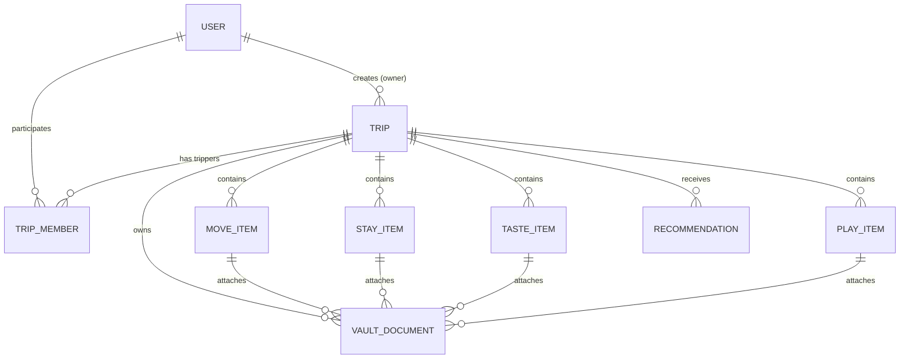
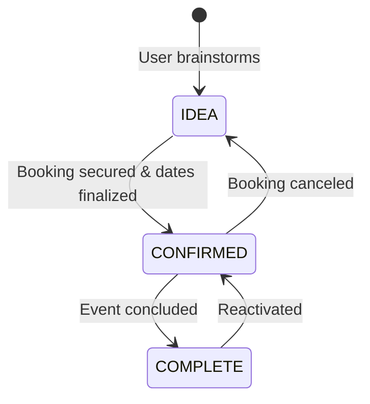

# Canonical Data Model & Schema Specification — Sonderring

> **Document Status**: Canonical & Living  
> **Version**: 1.0.0  
> **Scope**: Relational Entities, Attributes, Constraints, and State Machines  
> **Implementation Target**: Database & Language Agnostic (SQL, NoSQL, ORM)  

---

## 1. Entity-Relationship Architecture (ERD)

---

## 2. Core Entity Definitions

### 2.1. `TripSpace` (Entity: `Trip`)
The top-level canvas representing a journey.

| Attribute Name | Data Type | Nullable | Constraints / Defaults | Encryption | Description |
| :--- | :--- | :---: | :--- | :---: | :--- |
| `id` | UUIDv4 | ❌ | PRIMARY KEY | None | Globally unique identifier. |
| `title` | VARCHAR(150) | ❌ | None | None | Display title (e.g., *Iceland 26*). |
| `destination` | VARCHAR(200) | ❌ | Default: `""` | None | Location name or region. |
| `time_granularity`| ENUM / VARCHAR | ❌ | Default: `'EXACT_RANGE'` | None | `'EXACT_RANGE'`, `'MONTH'`, `'SEASON'`, `'YEAR'`, `'DAY_COUNT'`, `'APPROXIMATE'`, `'IDEA'`. |
| `start_date` | DATE | ✔️ | Optional | None | Starting date for exact ranges. |
| `end_date` | DATE | ✔️ | Optional | None | Ending date for exact ranges. |
| `status` | ENUM / VARCHAR | ❌ | Default: `'UPCOMING'` | None | `'UPCOMING'`, `'CURRENT'`, `'PAST'`. |
| `description` | TEXT | ✔️ | Optional | None | Freeform trip summary/overview. |
| `created_by` | UUID (FK) | ✔️ | ON DELETE SET NULL | None | Creator user reference. |
| `created_at` | TIMESTAMP | ❌ | Default: NOW() | None | Record creation timestamp. |
| `updated_at` | TIMESTAMP | ❌ | Auto-update | None | Last modified timestamp. |

---

### 2.2. `TripMember` (Membership & RBAC)
Associates users with trips and defines role boundaries.

| Attribute Name | Data Type | Nullable | Constraints / Defaults | Description |
| :--- | :--- | :---: | :--- | :--- |
| `id` | UUIDv4 | ❌ | PRIMARY KEY | Membership record ID. |
| `trip_id` | UUID (FK) | ❌ | ON DELETE CASCADE | Parent trip reference. |
| `user_id` | UUID (FK) | ❌ | ON DELETE CASCADE | Associated user reference. |
| `role` | ENUM / VARCHAR | ❌ | Default: `'EDITOR'` | `'OWNER'`, `'EDITOR'`, `'VIEWER'`. |
| `joined_at` | TIMESTAMP | ❌ | Default: NOW() | Time user joined the trip. |

---

### 2.3. Dimension Items (Common Invariants)
All items in Move, Stay, Taste, and Play share these foundational fields:
- `id`: UUIDv4 primary key.
- `trip_id`: UUID foreign key (CASCADE delete).
- `title`: String(150), mandatory item name.
- `status`: ENUM (`'IDEA'`, `'CONFIRMED'`, `'COMPLETE'`).
- `created_by` & `updated_by`: Foreign keys to users for audit tracking.
- `created_at` & `updated_at`: Standard audit timestamps.

---

### 2.4. `MoveItem` (Dimension: Move)
Transit, flights, rail, ferries, and vehicle rentals.

| Attribute Name | Data Type | Nullable | Choices / Constraints | Encryption | Description |
| :--- | :--- | :---: | :--- | :---: | :--- |
| `mode` | VARCHAR(50) | ❌ | `'Planes'`, `'Trains'`, `'Car'` | None | Primary transit type. |
| `origin` | VARCHAR(200) | ✔️ | Text | None | Departure city/station/code. |
| `destination` | VARCHAR(200) | ✔️ | Text | None | Arrival city/station/code. |
| `departure_date` | DATE | ✔️ | Mandatory if `CONFIRMED` | None | Date of transit. |
| `departure_time` | TIME | ✔️ | Optional | None | Scheduled time of departure. |
| `carrier` / `company`| VARCHAR(100)| ✔️ | Text (e.g., *Delta*) | None | Operating company. |
| `cost` | DECIMAL(10,2)| ✔️ | Positive number | None | Price in local/base currency. |
| `booking_link` | VARCHAR(500)| ✔️ | URL | None | Link to ticket or check-in. |
| `_encrypted_confirmation_code` | TEXT | ✔️ | Base64 AEAD Ciphertext | **AES-256-GCM** | Airline PNR or rental code. |
| `notes` | TEXT | ✔️ | Freeform text | None | General transit notes. |

---

### 2.5. `StayItem` (Dimension: Stay)
Lodging, hotels, homes, apartments, rooms, and campsites.

| Attribute Name | Data Type | Nullable | Choices / Constraints | Encryption | Description |
| :--- | :--- | :---: | :--- | :---: | :--- |
| `place_type` | VARCHAR(50) | ❌ | `'Hotel'`, `'Home'`, `'Apartment'`, `'Room'`, `'Bed'` | None | Lodging category. |
| `address` | TEXT | ✔️ | Text address | None | Physical location. |
| `stay_length` | INTEGER | ✔️ | Positive integer | None | Duration magnitude (e.g., `3`). |
| `stay_length_unit`| VARCHAR(20)| ✔️ | `'Day(s)'`, `'Week(s)'`, `'Month(s)'` | None | Duration unit. |
| `check_in` | DATE / TIMESTAMP | ✔️ | Mandatory if `CONFIRMED` | None | Check-in date. |
| `check_out` | DATE / TIMESTAMP| ✔️ | Mandatory if `CONFIRMED` | None | Check-out date ($>\text{check\_in}$). |
| `has_check_in_time` | BOOLEAN | ❌ | Default: `FALSE` | None | Whether specific time is set. |
| `has_check_out_time`| BOOLEAN | ❌ | Default: `FALSE` | None | Whether specific time is set. |
| `total_price` | DECIMAL(10,2)| ✔️ | Positive number | None | Total reservation cost. |
| `booking_link` | VARCHAR(500)| ✔️ | URL | None | Link to booking site/portal. |
| `_encrypted_confirmation_code` | TEXT | ✔️ | Base64 AEAD Ciphertext | **AES-256-GCM** | Hotel confirmation code. |
| `encrypted_notes` | TEXT | ✔️ | Base64 AEAD Ciphertext | **AES-256-GCM** | Lockbox, keypad door PINs. |
| `description` | TEXT | ✔️ | Plaintext notes | None | Non-sensitive house rules. |

---

### 2.6. `TasteItem` (Dimension: Taste)
Restaurants, dining spots, cafés, bars, wineries, and food markets.

| Attribute Name | Data Type | Nullable | Choices / Constraints | Encryption | Description |
| :--- | :--- | :---: | :--- | :---: | :--- |
| `taste_type` | VARCHAR(50) | ❌ | `'Food'`, `'Drink'` | None | Primary classification. |
| `cuisine` | VARCHAR(50) | ✔️ | `American`, `African`, `Asian`, `Contemporary`, `European`, `Fusion`, `Indian`, `Mediterranean`, `Mexican`, `South American` | None | Active when type is `Food`. |
| `drink_category` | VARCHAR(50) | ✔️ | `Beer`, `Cocktails`, `Wine`, `Tea & Coffee`, `Juice and Smoothies`, `Other` | None | Active when type is `Drink`. |
| `address` | TEXT | ✔️ | Text address | None | Physical venue location. |
| `price_tier` | VARCHAR(10) | ✔️ | `'$'`, `'$$'`, `'$$$'`, `'$$$$'` | None | Relative price rating. |
| `date` | DATE | ✔️ | Mandatory if `CONFIRMED` | None | Reservation date. |
| `time` | TIME | ✔️ | Optional | None | Reservation time. |
| `booking_link` | VARCHAR(500)| ✔️ | URL | None | Link to menu or OpenTable/Resy. |
| `_encrypted_confirmation_code` | TEXT | ✔️ | Base64 AEAD Ciphertext | **AES-256-GCM** | Reservation reference. |
| `description` | TEXT | ✔️ | Plaintext notes | None | Menu tips and dress code. |

> **Schema Invariant**: Taste items **do not have end_date or end_time** columns.

---

### 2.7. `PlayItem` (Dimension: Play)
Activities, tours, sightseeing, hikes, performances, and cultural visits.

| Attribute Name | Data Type | Nullable | Choices / Constraints | Encryption | Description |
| :--- | :--- | :---: | :--- | :---: | :--- |
| `play_type` | VARCHAR(50) | ❌ | `'Outdoors'`, `'Tours'`, `'Events'`, `'Sightseeing'`, `'Other'` | None | Activity type. |
| `address` | TEXT | ✔️ | Text address / coordinates | None | Location of activity. |
| `price_tier` | VARCHAR(10) | ✔️ | `'Free'`, `'$'`, `'$$'`, `'$$$'`, `'$$$$'` | None | Relative or fixed cost tier. |
| `tour_length` | VARCHAR(50) | ✔️ | Optional duration | None | Supported for Tour items. |
| `date` | DATE | ✔️ | Mandatory if `CONFIRMED` | None | Scheduled activity date. |
| `time` | TIME | ✔️ | Optional | None | Scheduled start time. |
| `booking_link` | VARCHAR(500)| ✔️ | URL | None | Guide link or ticket portal. |
| `_encrypted_confirmation_code` | TEXT | ✔️ | Base64 AEAD Ciphertext | **AES-256-GCM** | Ticket or voucher code. |
| `description` | TEXT | ✔️ | Plaintext notes | None | Gear needed, trail notes. |

---

### 2.8. `VaultDocument` (Secure File Attachment)

| Attribute Name | Data Type | Nullable | Constraints / Defaults | Description |
| :--- | :--- | :---: | :--- | :--- |
| `id` | UUIDv4 | ❌ | PRIMARY KEY | Document unique ID. |
| `trip_id` | UUID (FK) | ❌ | ON DELETE CASCADE | Parent trip reference. |
| `file_path` | VARCHAR(500)| ❌ | `media/vault/YYYY/MM/<uuid>.<ext>` | Obfuscated physical path. |
| `original_name`| VARCHAR(255)| ❌ | Preserved display name | User's upload filename. |
| `mime_type` | VARCHAR(100)| ❌ | Whitelisted MIME | `application/pdf`, `image/png`, etc. |
| `file_size` | INTEGER | ❌ | In bytes | Storage verification. |
| `item_type` | VARCHAR(20) | ✔️ | `'move'`, `'stay'`, `'taste'`, `'play'` | Dimension association. |
| `item_id` | UUID | ✔️ | Associated item ID | Generic link to specific item. |
| `uploaded_by` | UUID (FK) | ✔️ | ON DELETE SET NULL | Uploader identity. |
| `uploaded_at` | TIMESTAMP | ❌ | Default: NOW() | Time of upload. |

---

## 3. Readiness State Machine Rules

| Dimension | State: `IDEA` Validation | State: `CONFIRMED` Validation | State: `COMPLETE` Validation |
| :--- | :--- | :--- | :--- |
| **Move** | Dates, times, cost, code optional. | Mandatory `departure_date`. Departure time optional. | Preserves date & transit history. |
| **Stay** | Dates, duration, code optional. | Mandatory `check_in` & `check_out` (`check_out` > `check_in`). | Preserves lodging history. |
| **Taste** | Date and time optional. | Mandatory `date`. Time optional. No end date allowed. | Preserves dining memory. |
| **Play** | Date and time optional. | Mandatory `date`. Time optional. | Preserves activity history. |
