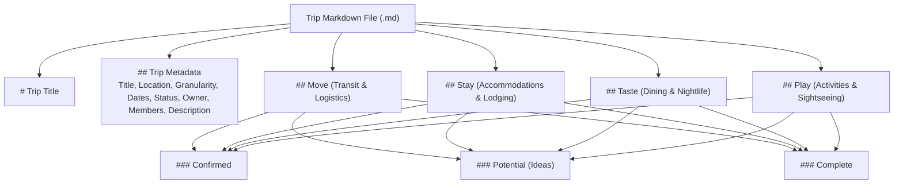
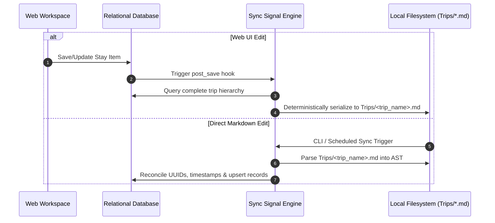

# Markdown Storage & Bidirectional Sync Specification — Sonderring

> **Document Status**: Canonical & Living  
> **Version**: 1.0.0  
> **Scope**: Plaintext Serialization Grammar, Parsing Rules, and Sync Protocols  
> **Implementation Target**: Language Agnostic (Filesystem / Git Archive)  

---

## 1. Specification Overview

Sonderring maintains an active link between its relational database state and human-readable, version-controlled Markdown documents stored in `Trips/*.md`. This provides:
1. **Offline Accessibility**: Travelers can read their complete itinerary in any standard text editor or terminal without an internet connection.
2. **Git-Native Backups**: Trip spaces can be archived, diffed, and versioned via Git.
3. **Dual-Direction Authoring**: Edits made in web UI forms sync out to `.md` files; edits made directly in `.md` files can be parsed and imported back into the database.

---

## 2. Canonical Markdown Grammar & Section Invariants

Every trip document stored in `Trips/*.md` must conform strictly to this structural grammar. Parsers must reject or correct malformed documents.



### 2.1. Exact Section Order
1. **Document Header**: `# <Trip Title>`
2. **Metadata Header**: `## Trip Metadata` (or `## TripSpace Metadata`)
   - `* **Trip Title**: <string>`
   - `* **Location**: <string>`
   - `* **Time Granularity**: <EXACT_RANGE | MONTH | SEASON | YEAR | APPROXIMATE | DAY_COUNT | IDEA>`
   - `* **Dates**: <start> – <end>`
   - `* **Status**: <UPCOMING | CURRENT | PAST>`
   - `* **Owner (`created_by`)**: @<username>`
   - `* **Trippers (`trip_members`)**: <list of @usernames and roles>`
   - `* **Description**: <text>`
3. **`## Move`**:
   - `### Confirmed`
   - `### Potential`
   - `### Complete`
4. **`## Stay`**:
   - `### Confirmed`
   - `### Potential`
   - `### Complete`
5. **`## Taste`**:
   - `### Confirmed`
   - `### Potential`
   - `### Complete`
6. **`## Play`**:
   - `### Confirmed`
   - `### Potential`
   - `### Complete`

> **Empty Section Rule**: If a subsection has zero items, the serializer must output `*None recorded.*`.

---

## 3. Dimension Item Serialization Format

### 3.1. Move Item Format
```markdown
* **Delta Flight DL 938**
  * **Mode**: Planes
  * **Carrier**: Delta Airlines
  * **Route**: LAX ➔ KEF
  * **Departure**: Oct 13, 2026 at 3:25 PM
  * **Cost**: $845.20
  * **Confirmation Code**: `GH9L7T` (Encrypted AES-256)
  * **Link**: https://delta.com
  * **Notes**: Terminal 2, seats 14A/14B
  * **Attribution**: Added by `@leila` · Last edited by `@leila`
```

### 3.2. Stay Item Format
```markdown
* **Hotel Grímsborgir**
  * **Place Type**: Hotel
  * **Address**: Asborgir 30, Selfoss, 801, Iceland
  * **Duration**: 3 Nights (Oct 14, 2026 – Oct 17, 2026)
  * **Cost**: $950.00
  * **Confirmation Code**: `HG-984210` (Encrypted AES-256)
  * **Notes**: Door keypad PIN: 4829 (Encrypted AES-256)
  * **Link**: https://grimsborgir.is
  * **Attribution**: Added by `@leila` · Last edited by `@leila`
```

### 3.3. Taste Item Format
```markdown
* **Kol Restaurant**
  * **Taste Type**: Food
  * **Cuisine**: Contemporary
  * **Address**: Skólavörðustígur 40, 101 Reykjavík
  * **Price**: $$$
  * **Date**: Oct 15, 2026 at 7:30 PM
  * **Booking Reference**: `KOL-7712` (Encrypted AES-256)
  * **Link**: https://kolrestaurant.is
  * **Notes**: Tasting menu reserved for 3 people
  * **Attribution**: Added by `@leila` · Last edited by `@leila`
```

### 3.4. Play Item Format
```markdown
* **Inside the Volcano Tour**
  * **Play Type**: Tours
  * **Length**: 4 Hours
  * **Address**: Thrihnukagigur Volcano Base Camp
  * **Price**: $$$$
  * **Date**: Oct 16, 2026 at 10:00 AM
  * **Confirmation Code**: `VOLC-883921` (Encrypted AES-256)
  * **Link**: https://insidethevolcano.com
  * **Notes**: Bring waterproof hiking boots
  * **Attribution**: Added by `@leila` · Last edited by `@leila`
```

---

## 4. Parser & Synchronization Engine Rules



### 4.1. Conflict Resolution Policy
1. **Timestamp-Based Last-Write-Wins**: When resolving collisions between database records and markdown edits, the record with the most recent `updated_at` / file mtime takes precedence.
2. **Encryption Invariant on Sync**: When parsing a markdown file containing a plaintext confirmation code (e.g., entered manually by the user in an editor), the parser **must pass the value through the AES-256-GCM encryption engine** before committing it to database storage.
3. **Whitespace & Sanitization**: Parser must normalize bullet indentations (2 or 4 spaces) and tolerate missing optional fields without failing.
