# MVP Scope Specification & Phasing Roadmap — Sonderring

> **Document Status**: Canonical & Living  
> **Version**: 1.0.0  
> **Scope**: Minimum Viable Product Definition & Multi-Phase Roadmap  
> **Implementation Target**: Programming Language & Framework Agnostic  

---

## 1. Executive Summary & Strategy

The primary goal of the **Sonderring MVP (Phase 1)** is to deliver a rock-solid, secure collaborative workspace that proves the core value proposition:
1. Structuring chaotic travel plans into the **four foundational dimensions**: **Move**, **Stay**, **Taste**, and **Play**.
2. Frictionless progression from brainstorm to booking via the **status-first readiness flow** (`IDEA` $\rightarrow$ `CONFIRMED` $\rightarrow$ `COMPLETE`).
3. Enterprise-grade **application-level encryption** for sensitive booking codes and property access credentials.
4. Deterministic **plaintext Markdown synchronization** to maintain parity between web views and local planning archives.

By strictly scoping Phase 1, engineering teams can deliver a production-ready system rapidly without getting bogged down in third-party API integrations (e.g., flight tracking or automated geocoding) which are systematically scheduled for Phase 2.

---

## 2. Phase 1: MVP Feature Matrix (In-Scope)

```mermaid
flowchart LR
    subgraph MVP["<b>Phase 1: Core MVP (In-Scope)</b>"]
        TS["TripSpace & Hybrid Granularity"]
        DIM["4 Dimensions (Move, Stay, Taste, Play)"]
        FLOW["Status-First Question Flow"]
        SEC["AES-256-GCM Field Encryption"]
        VAULT["Secure Document Vault"]
        SYNC["Trips/*.md Markdown Sync"]
    end
    subgraph P2["<b>Phase 2: Platform Enhancements</b>"]
        GEO["Google Places Autosuggest"]
        FLIGHT["Live Flight Tracking API"]
        PRES["Real-time Presence & Collaboration"]
    end
    subgraph P3["<b>Phase 3: Native Ecosystem</b>"]
        MOBILE["iOS & Android Native Apps"]
        OCR["AI Ticket / PDF Parsing"]
        EXPENSE["Expense Splitting & FX Settlement"]
    end
    MVP --> P2 --> P3
```

---

### 2.1. TripSpace Management & Metadata
- [x] **Create & Manage TripSpaces**: Title, Destination Location, Description, Time Granularity, and Dates.
- [x] **Hybrid Time Granularity**:
  - `EXACT_RANGE` (Start Date – End Date)
  - `MONTH` (e.g., October 2026)
  - `SEASON` (e.g., Fall 2026)
  - `YEAR` (e.g., 2026)
  - `DAY_COUNT` (e.g., 5 Days)
  - `APPROXIMATE` / `IDEA` (Open-ended idea)
- [x] **Dashboard Quick-Status**: One-click inline status toggle (`UPCOMING`, `CURRENT`, `PAST`) directly from the trip index cards without full-page navigation.
- [x] **Ownership & Membership**: Creator assigned as `OWNER`; ability to invite collaborators with `EDITOR` or `VIEWER` roles.

---

### 2.2. The Status-First Modal Flow (All Dimensions)
- [x] **Two-Step Question Modal**:
  - **Step 1**: Dedicated question asking for the item's status (**Idea**, **Confirmed**, **Complete**).
  - **Step 2**: The tailored form displaying primary fields and expandable options.
- [x] **Status Flow Bar**: A persistent bar at the top of Step 2 showing the active status and providing a "Change Status" action that preserves entered input data.
- [x] **Adaptive Validation Rules**:
  - **`IDEA`**: All dates, times, and confirmation codes are optional.
  - **`CONFIRMED`**: Move, Taste, and Play require a single `date`; Stay requires both `check_in` and `check_out`.
  - **`COMPLETE`**: Preserves event history and dates.
- [x] **Universal Base Inputs**: Every item has Name*, Status*, Type, Link, Notes, and an expandable "More Options" toggle.

---

### 2.3. Dimension-Specific Item Capabilities

#### ✈️ Move Dimension (In-Scope)
- **Types**: `Planes`, `Trains`, `Car`.
- **Primary Inputs**: Name*, Status*, Type, Origin, Destination, Web Link, Notes.
- **More Options**:
  - Departure Date (Required if `CONFIRMED`)
  - Departure Time (Prominently rendered for `Planes` and `Trains`)
  - Carrier / Company name (e.g., Delta Airlines, Hertz)
  - Price (Numeric decimal)
  - Confirmation Code (AES-256 encrypted)
  - Upload Documents (PDF, PNG, JPG)

#### 🏨 Stay Dimension (In-Scope)
- **Types**: `Hotel`, `Home`, `Apartment`, `Room`, `Bed`.
- **Primary Inputs**: Name*, Status*, Type, Address / Location, Web Link, Notes.
- **More Options**:
  - Stay Length (Integer input) + Unit Selector (`Day(s)`, `Week(s)`, `Month(s)`)
  - Start Date (Check-in) & End Date (Check-out) (Required if `CONFIRMED`; chronological validation enforced)
  - Check-in & Check-out Times (Optional)
  - Total Price (Numeric decimal)
  - Confirmation Code (AES-256 encrypted; conditionally highlighted for Confirmed stays)
  - Upload Documents

#### 🍽️ Taste Dimension (In-Scope)
- **Types**: `Food`, `Drink`.
- **Primary Inputs**: Name*, Status*, Type, Location, Web Link, Notes.
- **Dynamic Branching**:
  - `Food` $\rightarrow$ Cuisine dropdown (American, African, Asian, Contemporary, European, Fusion, Indian, Mediterranean, Mexican, South American).
  - `Drink` $\rightarrow$ Category dropdown (Beer, Cocktails, Wine, Tea & Coffee, Juice and Smoothies, Other).
- **More Options**:
  - Price Tier buttons (`$`, `$$`, `$$$`, `$$$$`)
  - Single Date (Required if `CONFIRMED`, optional if `IDEA`)
  - Booking Reference / Confirmation Code (AES-256 encrypted)
  - Upload Documents
- **Invariant**: No end dates or times exist for Taste items.

#### 🎭 Play Dimension (In-Scope)
- **Types**: `Outdoors`, `Tours`, `Events`, `Sightseeing`, `Other`.
- **Primary Inputs**: Name*, Status*, Type, Location, Web Link, Notes.
- **More Options**:
  - Price Tier buttons (`Free`, `$`, `$$`, `$$$`, `$$$$`)
  - Date (Required if `CONFIRMED`, optional if `IDEA`)
  - Time (Optional)
  - Confirmation Code (AES-256 encrypted)
  - Upload Documents
- **Category Rule**: Items categorized as `Tour` support an optional `length` / duration attribute.

---

### 2.4. Security, Vault & Storage (In-Scope)
- [x] **Field-Level Encryption**: Application-layer AES-256-GCM encryption for confirmation codes, booking references, and private lockbox/door notes.
- [x] **Document Vault**: Uploaded PDFs and images stored under obfuscated UUID paths (`media/vault/YYYY/MM/<uuid>.<ext>`).
- [x] **Access Control**: Session-authenticated download endpoints verifying trip membership.
- [x] **Markdown Sync**: Real-time bi-directional sync matching canonical templates in `Trips/*.md`.

---

## 3. Explicitly Deferred to Phase 2 (Post-MVP Enhancements)

The following capabilities are deliberately excluded from Phase 1 to guarantee focused, robust delivery of the core engine:

| Capability | Deferred Reason | Planned Phase |
| :--- | :--- | :--- |
| **Google Places / Maps API Autosuggest** | Eliminates external API key dependencies and billing during MVP; text input suffices. | Phase 2 |
| **Live Flight Tracking & Gate Alerts** | Requires integration with aviation telematics providers (FlightAware/Cirium). | Phase 2 |
| **Real-Time Multi-Cursor Collaboration** | Adds WebSocket/CRDT server complexity; standard optimistic UI + sync is adequate for MVP. | Phase 2 |
| **Public Recommendation Voting / Ranking** | Recommendation intake exists in MVP; upvoting/downvoting scoring algorithms deferred. | Phase 2 |
| **Automated Calendar Subscription (iCal feed)** | Standard export/sync is handled via Markdown in MVP; `.ics` feed generation planned for P2. | Phase 2 |
| **Granular Dimension Permissions** | In MVP, access is trip-level (`OWNER`, `EDITOR`, `VIEWER`); per-dimension permissions deferred. | Phase 2 |

---

## 4. Long-Term Vision: Phase 3 (Ecosystem & Intelligence)

- **Native Mobile Apps**: Dedicated Swift (iOS) and Kotlin (Android) apps communicating with the REST API.
- **AI-Powered Document Parsing (OCR)**: Automatically extracting confirmation numbers, check-in times, and terminal gates from uploaded PDF boarding passes.
- **Shared Expense & Multi-Currency Settlement**: Split-fare ledger, bill splitting per dimension, and automated currency conversion.
- **Offline PWA / SQLite Sync**: Full offline-first local database replication on client devices with reconciliation.

---

## 5. MVP Release Acceptance Checklist

Prior to declaring the MVP ready for general release, the implementation must pass the following verification gates:

1. **Nomenclature Integrity**:
   - Zero references to legacy terms ("navs", "dos", "elements" as standalone concepts).
   - Strict hierarchy: TripSpace $\rightarrow$ Dimension $\rightarrow$ Item $\rightarrow$ Category.
2. **Form Flow Verification**:
   - All 4 dimension modals verify status first (`IDEA`, `CONFIRMED`, `COMPLETE`).
   - Switching status via the Status Flow Bar preserves user-typed inputs.
3. **Data Integrity & Validation**:
   - Confirmed Stay items reject submission without valid, chronological `check_in` and `check_out` dates.
   - Confirmed Move, Taste, and Play items reject submission without a valid single `date`.
   - Taste items accept no end date or end time.
4. **Security Verification**:
   - Direct database inspection (`SELECT * FROM core_stay`) confirms that confirmation codes and door codes are stored as AES-256 ciphertexts.
   - Direct HTTP inspection verifies that unauthenticated requests to document vault URLs return 401/403.
5. **Bidirectional Markdown Sync**:
   - Edits in the UI immediately produce valid, formatted markdown files in `Trips/*.md`.
   - Modifying a `Trips/*.md` file updates database state upon fixture sync.
