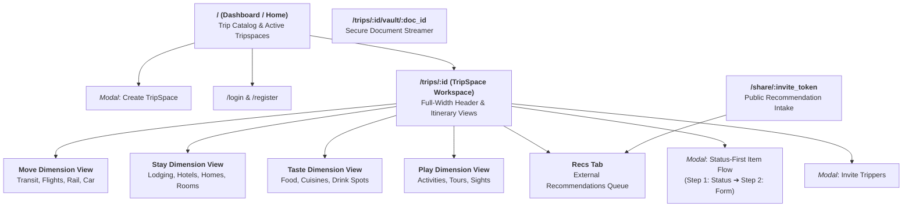

# Site Architecture, Page Inventory & Interaction Flows — Sonderring

> **Document Status**: Canonical & Living  
> **Version**: 1.0.0  
> **Scope**: UI Information Architecture, Route Inventory, and Modal Flows  
> **Implementation Target**: Programming Language & Frontend Framework Agnostic  

---

## 1. Information Architecture & Route Sitemap



---

## 2. Page & Screen Inventory

### 2.1. Home & Trip Dashboard (`/`)
- **Header / Navigation Bar**:
  - Sonderring Brand Logo.
  - **Active TripSpaces Dropdown**: Quick switcher listing all ongoing and upcoming trips.
  - **"Create Trip" Button**: Opens the global Trip Creation Modal.
  - User Profile Menu & Logout.
- **Trip Index Sections**:
  - **Active & Upcoming Journeys**: Cards showing trips where status is `CURRENT` or `UPCOMING`.
  - **Exploratory & Idea Trips**: Journeys with open-ended time granularity (`IDEA`, `APPROXIMATE`).
  - **Past Adventures**: Archived trips where status is `COMPLETE` or `PAST`.
- **Trip Card Component**:
  - Destination Cover / Badge, Trip Title, Dates / Granularity label, Trippers avatar stack.
  - **Interactive Status Pill**: Allows inline status toggle without leaving the page (via asynchronous update).

---

### 2.2. TripSpace Workspace (`/trips/:id`)
The core collaborative canvas representing a single journey.

#### 2.2.1. Full-Width Workspace Header
- **Trip Title & Destination**: Prominent editable title and geographic location.
- **Time Granularity & Dates**: Start and end date range or seasonal label.
- **Status Indicator**: Current trip readiness (`UPCOMING`, `CURRENT`, `PAST`).
- **Tripper Stack**: Avatars of all confirmed members; "+" button to open Invite Modal.
- **Share / Recommendations Action**: Generates and copies the external public intake URL.

#### 2.2.2. Dimension Navigation & Layout
- Supports a **4-Column Multi-View** (Desktop) or **Tabbed Segmented View** (Mobile/Tablet):
  1. ✈️ **Move View**
  2. 🏨 **Stay View**
  3. 🍽️ **Taste View**
  4. 🎭 **Play View**
  5. 💡 **Recs Queue Tab**
- Each dimension container features:
  - **Dimension Header**: Dimension Title, item counter, and primary "Add Item" button.
  - **Dimension Notes Component**: Collapsible note section at the top of the dimension container for general guidelines, transit passes, or packing reminders.
  - **Readiness State Groupings**:
    - **Confirmed Section**: Scheduled bookings with fixed dates.
    - **Ideas Section**: Brainstormed wishlist items.
    - **Complete Section**: Concluded historical items.

#### 2.2.3. Dimension Item Cards
- **Move Card**:
  - Mode icon (Plane, Train, Car), Origin $\rightarrow$ Destination arrow.
  - Departure Date and Time badge.
  - Carrier / Company, Cost, encrypted Confirmation Code badge with copy button.
  - Document attachment indicator (opens Vault viewer).
- **Stay Card**:
  - Lodging type (Hotel, Home, Apartment, Room, Bed).
  - Address / Map link, Check-in to Check-out date span, Duration badge (e.g., "3 Nights").
  - Cost, Encrypted Confirmation Code badge, Lockbox/door keypad reveal button.
- **Taste Card**:
  - Type (Food / Drink), Cuisine or Drink Category badge.
  - Venue address, Price tier indicator (`$$`), Scheduled reservation date.
  - Booking reference badge, Menu link button.
- **Play Card**:
  - Type (Outdoors, Tours, Events, Sightseeing), Location.
  - Tour duration badge (if applicable), Date and Time, Price tier (`Free` or `$`).
  - Confirmation voucher badge, Guide link.

---

### 2.3. Public Recommendation Intake Portal (`/share/:invite_token`)
- **Audience**: Friends and family who are *not* traveling on the trip.
- **Layout**: Distraction-free, mobile-first intake form.
- **Inputs**:
  - Your Name (Recommender attribution).
  - Place / Experience Name.
  - Dimension Selection (Move, Stay, Taste, Play).
  - Recommended Sub-category (e.g., Wine Bar, Hike, Hotel).
  - Address or Web Link.
  - Why You Recommend It (Notes/Tip).
- **Behavior**: Submissions do not modify the active itinerary; they populate the TripSpace **Recs Queue** for review.

---

### 2.4. Secure Document Streamer (`/trips/:id/vault/:doc_id`)
- **Layout**: Clean full-page PDF/image viewer or direct binary download stream.
- **Security Check**: Enforces session authentication and validates user membership in `trip_members`.

---

## 3. The Status-First Modal Interaction Flow

Every "Add Item" modal across all four dimensions follows a standardized two-step pattern:

```mermaid
sequenceDiagram
    autonumber
    actor User as Traveler
    participant UI as Add Modal Component
    participant Form as Form Controller

    User->>UI: Click "Add [Dimension] Item"
    UI->>User: Render Step 1: Status Question Prompt
    Note over UI: "What is the status of this stay / transit / spot / activity?"<br>Select: [Idea] [Confirmed] [Complete]
    User->>UI: Selects "Confirmed"
    UI->>Form: Transition to Step 2 with status="CONFIRMED"
    Form-->>UI: Render Form with Mandatory Date Validation & Status Flow Bar
    User->>UI: Inputs Name, Dates, Details
    opt User changes mind
        User->>UI: Clicks "Change Status" in Status Flow Bar
        UI->>Form: Updates active validation to "IDEA" without clearing fields
    end
    User->>UI: Submit Form
    UI->>User: Modal closes; Item renders in Confirmed section
```

### 3.1. Modal Form Layout Hierarchy
1. **Header**: Modal Title (e.g., *"Add Stay Item"*), Close button (`×`).
2. **Status Flow Bar**: Visible in Step 2; displays active readiness badge and a *"Change Status"* link.
3. **Primary Inputs (Immediate View)**:
   - Name* (Title)
   - Type (Dimension-specific dropdown)
   - Location / Origin-Destination
   - Web Link
   - Notes / Description
4. **Expandable "More Options" Toggle**:
   - Button: `⚙️ More Options ▾`
   - Unfolds secondary inputs: Duration, Dates/Times, Price, Encrypted Confirmation Code, File Upload.
5. **Footer**: Cancel button, Save button (adaptive label: *"Save Item Idea"* vs. *"Save Confirmed Item"*).

---

## 4. Responsive Layout Breakpoints

| Breakpoint | Target Devices | Layout Behavior |
| :--- | :--- | :--- |
| **Desktop ($> 1024\text{px}$)** | Desktops, Laptops | Full 4-column dimension workspace displaying Move, Stay, Taste, and Play simultaneously side-by-side. |
| **Tablet ($768\text{px} - 1024\text{px}$)** | iPads, Tablets | 2-column responsive grid or full-width segmented tab switcher with quick swipe. |
| **Mobile ($< 768\text{px}$)** | Smartphones | Sticky bottom navigation bar switching between dimensions; modal controls expand to full-screen drawers. |
