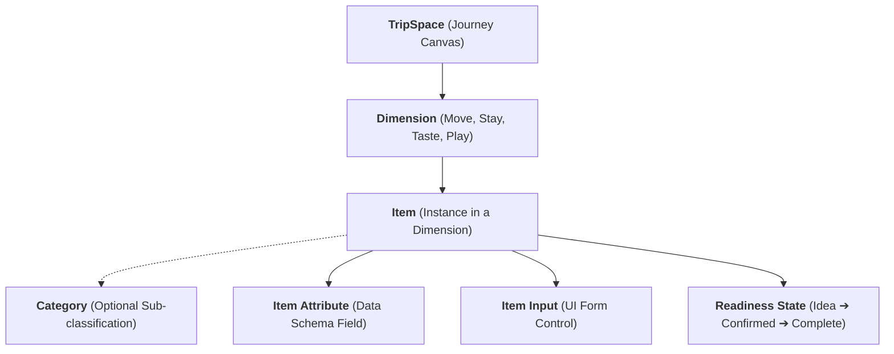

# Product Requirements Document (PRD) — Sonderring

> **Document Status**: Canonical & Living  
> **Version**: 1.0.0  
> **Domain Architecture**: Sonderring & TripSpaces  
> **Target Audience**: Product Managers, Engineering Teams, Security Architects, QA  
> **Implementation Scope**: Programming Language & Framework Agnostic  

---

## 1. Executive Summary & Vision

### 1.1. The Problem
Travel planning is fragmented across chaotic spreadsheets, unstructured group chats, and rigid calendar tools. Most itinerary apps enforce premature scheduling (forcing specific dates and hours on early ideas) or lack cybersecurity protections for sensitive personal travel data such as hotel door keypad codes, airline confirmation numbers, and passport/ticket PDFs.

### 1.2. The Solution
**Sonderring** is a secure, collaborative travel workspace that structures every journey into an expressive **TripSpace**. Journeys are organized around four universal human pillars—**Move**, **Stay**, **Taste**, and **Play**—governed by a **status-first readiness flow** (`IDEA` $\rightarrow$ `CONFIRMED` $\rightarrow$ `COMPLETE`). 

Sonderring bridges early brainstorming with confirmed logistics while enforcing zero-knowledge security standards: high-value booking references and access credentials are encrypted at the application layer before reaching persistence.

---

## 2. Domain Terminology & System Boundaries

Any implementation of Sonderring must adhere to the official **TripSpace Nomenclature**:

1. **TripSpace (Level 1)**: The top-level collaborative trip workspace (e.g., *Iceland 26*, *Malticilia 26*).
2. **Dimension (Level 2)**: One of the 4 foundational pillars:
   - ✈️ **Move**: Transit, flights, rail, ferries, driving routes, car rentals.
   - 🏨 **Stay**: Lodging, hotels, villas, campgrounds, apartments, rooms.
   - 🍽️ **Taste**: Restaurants, cafés, street food, bars, wineries.
   - 🎭 **Play**: Activities, tours, sights, hikes, performances, museums.
3. **Item (Level 3)**: A concrete plan or reservation belonging to a Dimension (Move Item, Stay Item, Taste Item, Play Item). **Core Invariant**: Every item must belong to a dimension.
4. **Category (Optional Sub-classification)**: A domain sub-group strictly bound to its dimension (e.g., *Tour* is always a Play Item; *Wine Bar* is always a Taste Item).
5. **Item Input (Frontend)** vs. **Item Attribute (Backend)**: Form controls and modal fields are decoupled from database columns. Removing an input from a UI form does not alter backend schema integrity.
6. **Readiness States**:
   - `IDEA`: Exploratory brainstorm; dates and times are strictly optional.
   - `CONFIRMED`: Booked reservation; requires date constraints.
   - `COMPLETE`: Concluded historical event.

---

## 3. Target User Personas

| Persona | Role | Primary Goals | Key Pain Points |
| :--- | :--- | :--- | :--- |
| **The Lead Organizer** | Trip Owner | Centralize group logistics, verify reservations, store sensitive lockbox codes securely. | Fragmented docs, accidental overwrites, exposing booking codes to unverified viewers. |
| **The Tripper** | Trip Member (Editor) | Add exploratory ideas, view confirmed itinerary, upload tickets. | Clunky tools requiring rigid dates for simple suggestions. |
| **The Contributor** | External Recommender | Suggest restaurants and activities via an invite link without viewing private travel plans. | Forcing account creation just to give a quick recommendation. |

---

## 4. Functional Requirements (FR)

### 4.1. TripSpace Management
- **FR-1.1**: The system must allow users to create a TripSpace with a Title, Location, Description, Time Granularity, and Dates.
- **FR-1.2**: Support **Hybrid Time Granularity**:
  - `EXACT_RANGE`: Start date to end date (e.g., Oct 30 – Nov 02, 2026).
  - `MONTH`: Calendar month & year (e.g., October 2026).
  - `SEASON`: Seasonal identifier (e.g., Fall 2026).
  - `YEAR`: Calendar year (e.g., 2026).
  - `DAY_COUNT`: Relative duration without fixed dates (e.g., "7 Days").
  - `APPROXIMATE` / `IDEA`: Open-ended planning canvas.
- **FR-1.3**: TripSpace Status must support `UPCOMING`, `CURRENT`, and `PAST`. Users must be able to change status directly from catalog/dashboard views without entering the workspace.
- **FR-1.4**: Ownership & Access Control: The creator is the default `OWNER`. Owners can invite `EDITOR` and `VIEWER` trippers.

### 4.2. Status-First Item Lifecycle & Modal Flow
- **FR-2.1**: When adding or editing any item across all dimensions, the UI must present **Status Selection as Step 1**:
  - Question: *"What is the status of this [stay / transit leg / food & drink spot / activity]?"*
  - Selectable choices: **Idea** (`IDEA`), **Confirmed** (`CONFIRMED`), **Complete** (`COMPLETE`).
- **FR-2.2**: Selecting a status dynamically transitions the modal to Step 2 (Form Inputs) configured with readiness-specific validation.
- **FR-2.3**: Step 2 must provide a sticky **Status Flow Bar** enabling the user to switch the status at any time without resetting already-typed form inputs.
- **FR-2.4**: Validation Rules by Readiness State:
  - `IDEA`: All dates and times are strictly optional.
  - `CONFIRMED`:
    - Move, Taste, Play: Mandatory single date (`date`); time is optional.
    - Stay: Mandatory check-in (`check_in`) and check-out (`check_out`) dates; times optional. Check-out must not precede check-in.
  - `COMPLETE`: Archived past event; preserves dates and history.

### 4.3. Dimension Specifications & Item Inputs

Every item across all four dimensions possesses **Base Inputs**:
- Name / Title* (Required string)
- Status* (Preset by Step 1, required)
- Type (Dimension-specific dropdown)
- Web Link (Optional URL)
- Notes / Description (Optional text area)
- Expandable "More Options" toggle for secondary and specialized inputs.

#### 4.3.1. Move Dimension Items
- **Primary Inputs**: Name*, Status*, Type (`Planes`, `Trains`, `Car`), Origin, Destination, Web Link, Notes.
- **More Options**:
  - Departure Date (Mandatory if `CONFIRMED`)
  - Departure Time (Prominent for `Planes` and `Trains`)
  - Company / Carrier (e.g., Delta Airlines, Hertz)
  - Price (Decimal / Currency)
  - Confirmation Code (Encrypted)
  - Upload Documents (Boarding passes, tickets)

#### 4.3.2. Stay Dimension Items
- **Primary Inputs**: Name*, Status*, Type (`Hotel`, `Home`, `Apartment`, `Room`, `Bed`), Location / Address, Web Link, Notes.
- **More Options**:
  - Stay Length (Integer duration) paired with Unit Selector (`Day(s)`, `Week(s)`, `Month(s)`)
  - Start Date / Check-in (Mandatory if `CONFIRMED`)
  - End Date / Check-out (Mandatory if `CONFIRMED`)
  - Total Price (Decimal / Currency)
  - Confirmation Code (Encrypted)
  - Upload Documents (Hotel confirmations, leases)

#### 4.3.3. Taste Dimension Items
- **Primary Inputs**: Name*, Status*, Type (`Food`, `Drink`), Location / Venue, Web Link, Notes.
- **Dynamic Categorization**:
  - If Type is `Food`: Display **Cuisine** dropdown (`American`, `African`, `Asian`, `Contemporary`, `European`, `Fusion`, `Indian`, `Mediterranean`, `Mexican`, `South American`).
  - If Type is `Drink`: Display **Category** dropdown (`Beer`, `Cocktails`, `Wine`, `Tea & Coffee`, `Juice and Smoothies`, `Other`).
- **More Options**:
  - Price Tier (Interactive buttons: `$`, `$$`, `$$$`, `$$$$`)
  - Date (Mandatory if `CONFIRMED`, optional if `IDEA`)
  - Booking Reference / Confirmation Code (Encrypted)
  - Upload Documents (Menu PDFs, reservation vouchers)
- **Domain Invariant**: Taste items **do not possess end dates or end times**.

#### 4.3.4. Play Dimension Items
- **Primary Inputs**: Name*, Status*, Type (`Outdoors`, `Tours`, `Events`, `Sightseeing`, `Other`), Location / Venue, Web Link, Notes.
- **More Options**:
  - Price Tier (Interactive buttons: `Free`, `$`, `$$`, `$$$`, `$$$$`)
  - Date (Mandatory if `CONFIRMED`, optional if `IDEA`)
  - Time (Optional)
  - Confirmation Code (Encrypted)
  - Upload Documents (Event tickets, trail maps)
- **Category Rule**: Play items categorized as a `Tour` support an optional `length` / duration attribute.

### 4.4. Cybersecurity & Data Privacy
- **FR-4.1**: Application-level envelope encryption using **AES-256-GCM** for all confirmation codes, booking references, and lockbox/keypad notes.
- **FR-4.2**: Document Vault: Secure storage of uploaded travel attachments using cryptographic UUID filenames (`media/vault/YYYY/MM/<uuid>.<ext>`).
- **FR-4.3**: Authenticated streaming: Documents cannot be retrieved by guessing URLs; downloads require authenticated session and trip membership.

### 4.5. Offline & Plaintext Sync
- **FR-5.1**: Bidirectional synchronization between database state and structured Markdown representations in `Trips/*.md`.
- **FR-5.2**: Strict section ordering in markdown: Trip Metadata Header $\rightarrow$ `## Move` $\rightarrow$ `## Stay` $\rightarrow$ `## Taste` $\rightarrow$ `## Play` (with subsections `### Confirmed`, `### Potential`, `### Complete`).

---

## 5. Non-Functional Requirements (NFR)

- **NFR-1 (Security)**: Zero plaintext exposure of booking codes in database logs, backups, or REST API payloads to unauthenticated actors.
- **NFR-2 (Performance)**: Page render and API response latency must be $<200\text{ms}$ at p95 for standard trip payloads.
- **NFR-3 (Availability & Offline Resilience)**: Trip data must be exportable to deterministic Markdown files for offline accessibility.
- **NFR-4 (Accessibility)**: Web UI must meet WCAG 2.1 Level AA standards for color contrast, keyboard navigation, and screen reader labels.
- **NFR-5 (Extensibility)**: Clean RESTful and JSON-compatible domain contracts allowing multi-platform clients (Web, iOS, Android).
