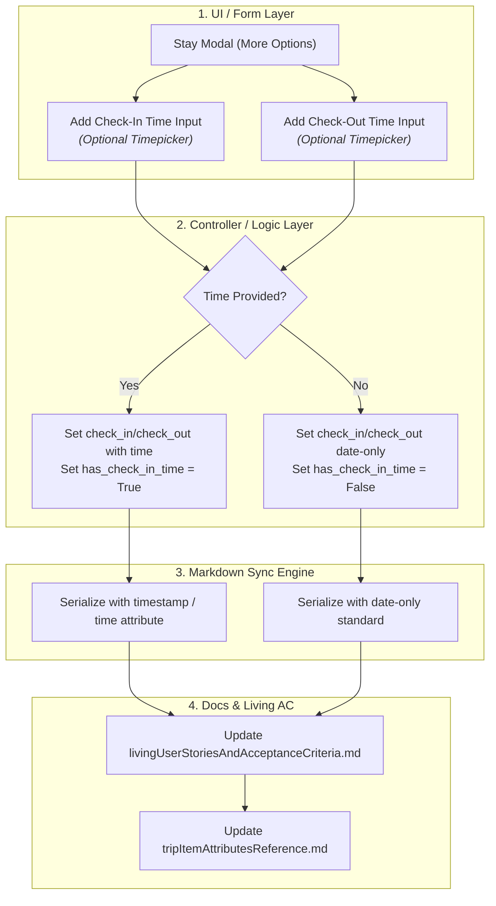

# Stay Check-In & Check-Out Time Attributes: Architecture & Extensibility

> **Document Status**: Canonical Fundamental Specification  
> **Traceability**: Linked to [`docs/TASKS.md`](../TASKS.md#task-003), [`docs/DATA_MODEL.md`](../DATA_MODEL.md), [`docs/tripItemAttributesReference.md`](../tripItemAttributesReference.md), [`docs/MARKDOWN_SYNC_SPEC.md`](../MARKDOWN_SYNC_SPEC.md), and [`AGENTS.md`](../../AGENTS.md).

---

## 1. Executive Summary & Architectural Verdict

> **Verdict**: **The current structure fully permits check-in and check-out time attributes without requiring database redesign or breaking changes.**

The backend relational schema for the **Stay** dimension already stores check-in and check-out values as full timestamps (`DateTimeField`) and includes native boolean flags (`has_check_in_time`, `has_check_out_time`) designed specifically to track whether an explicit time was provided.

The current constraint in [`AGENTS.md`](../../AGENTS.md) and [`tripItemAttributesReference.md`](../tripItemAttributesReference.md) (requiring strictly `Start Date` and `End Date` without explicit times) is an **intentional UI and presentation-layer convention** to keep trip entry minimal, fast, and concise. It is **not** a backend schema limitation.

---

## 2. Current State Architectural Audit

### 2.1. Relational Database Layer (`core/models.py`)
In the Django model definition for `Stay` ([`core/models.py`](file:///Users/leilagleich/Desktop/sonderring/core/models.py#L413-L416)):

```python
class Stay(models.Model):
    ...
    check_in = models.DateTimeField(blank=True, null=True)
    check_out = models.DateTimeField(blank=True, null=True)
    has_check_in_time = models.BooleanField(default=False)
    has_check_out_time = models.BooleanField(default=False)
    ...
```

| Field Name | Model Type | Purpose | Behavior When Date-Only | Behavior When Time Provided |
| :--- | :--- | :--- | :--- | :--- |
| `check_in` | `DateTimeField` | Check-in timestamp | Stored with midnight (`00:00:00`) or standard check-in hour. | Stored with exact specified local time. |
| `check_out` | `DateTimeField` | Check-out timestamp | Stored with midnight (`00:00:00`) or standard check-out hour. | Stored with exact specified local time. |
| `has_check_in_time` | `BooleanField` | Disambiguation flag | `False` | `True` |
| `has_check_out_time`| `BooleanField` | Disambiguation flag | `False` | `True` |

This dual-field pattern (`DateTimeField` + `BooleanField` flag) is the gold standard for travel platforms:
1. It avoids the need for separate, redundant `check_in_date` and `check_in_time` columns.
2. It allows chronological calendar/itinerary sorting without null-time sorting errors.
3. The boolean flag tells frontends and markdown serializers whether to render a time string or only render the date.

### 2.2. Frontend & Form Layer
* **Current Behavior**: The Stay Add/Edit modal displays only `Start Date` and `End Date` datepickers under the "More Options" toggle.
* **Extensibility**: Adding check-in/out times only requires exposing optional time input controls (`#inputStayCheckInTime`, `#inputStayCheckOutTime`) inside the existing "More Options" accordion. No database migration is needed.

### 2.3. Markdown Sync Specification Layer
* **Current Behavior**: Serializes stay duration as `* Duration: 3 Nights (Oct 14, 2026 – Oct 17, 2026)`.
* **Extensibility**: When `has_check_in_time` or `has_check_out_time` is `True`, the serializer can easily append the formatted time:
  ```markdown
  * Duration: 3 Nights (Oct 14, 2026 at 3:00 PM – Oct 17, 2026 at 11:00 AM)
  ```
  or include explicit optional key-value pairs:
  ```markdown
  * Check-in Time: 3:00 PM
  * Check-out Time: 11:00 AM
  ```

---

## 3. Critical Architectural Decision: Preservation vs. Deprecation (TASK-003)

An earlier draft of `TASK-003` proposed deprecating or dropping the check-in and check-out time attributes to strictly enforce the "date-only" UI convention at the database layer.

### Why Destructive Deprecation is Anti-Pattern:
1. **Irreversible Schema Churn**: Converting `DateTimeField` to `DateField` and dropping `has_check_in_time` would permanently discard time fidelity. Re-introducing times later would require creating new columns, data backfills, and database migrations.
2. **Loss of UI vs. DB Boundary**: As established in [`AGENTS.md`](../../AGENTS.md#3-ui-controls-vs-database-schema-boundaries), **Item Inputs** (UI controls) must be decoupled from **Item Attributes** (DB schema). Hiding an input in the UI does *not* require dropping the database column.

### Recommended Strategy for TASK-003:
Instead of dropping time attributes, **TASK-003** is structured to:
1. **Preserve the `DateTimeField` and flag architecture** in `core/models.py`.
2. **Keep the default UI experience date-focused** to maintain conciseness.
3. **Formalize the optional time picker inputs** in the Stay modal flow under "More Options" for users who specifically need to document non-standard check-in/out hours (e.g., late check-in at 11:30 PM, red-eye departures).

---

## 4. Implementation Roadmap for Activating Check-In / Check-Out Times



### 4.1. Form Input Design (UI)
Inside the Stay Add/Edit modal (under "More Options"):
```html
<div class="row g-2 mt-2">
  <div class="col-6">
    <label for="inputStayCheckInDate" class="form-label">Start Date *</label>
    <input type="date" id="inputStayCheckInDate" class="form-control" required>
    <label for="inputStayCheckInTime" class="form-label text-muted small mt-1">Check-in Time (Optional)</label>
    <input type="time" id="inputStayCheckInTime" class="form-control form-control-sm">
  </div>
  <div class="col-6">
    <label for="inputStayCheckOutDate" class="form-label">End Date *</label>
    <input type="date" id="inputStayCheckOutDate" class="form-control" required>
    <label for="inputStayCheckOutTime" class="form-label text-muted small mt-1">Check-out Time (Optional)</label>
    <input type="time" id="inputStayCheckOutTime" class="form-control form-control-sm">
  </div>
</div>
```

### 4.2. Invariant & Validation Rules
- **Date Invariant**: `check_out` date must be $\ge$ `check_in` date.
- **Time Invariant**: If `check_in` date equals `check_out` date (day use), `check_out` time must be strictly $>$ `check_in` time.
- **Graceful Nullability**: Both `has_check_in_time` and `has_check_out_time` default to `False`. If empty, the backend stores date with midnight/standard baseline.

---

## 5. Summary Checklist for TASK-003

When activating check-in and check-out time attributes:
- [ ] Retain `check_in` and `check_out` as `DateTimeField` in `core/models.py`.
- [ ] Retain `has_check_in_time` and `has_check_out_time` boolean flags.
- [ ] Expose optional timepicker inputs in Stay modal forms.
- [ ] Update `docs/tripItemAttributesReference.md` to document optional check-in/out times under "More Options".
- [ ] Update `docs/MARKDOWN_SYNC_SPEC.md` to parse and emit optional stay times.
- [ ] Update `docs/livingUserStoriesAndAcceptanceCriteria.md` with test scenarios for date-only stays vs. timestamped stays.
