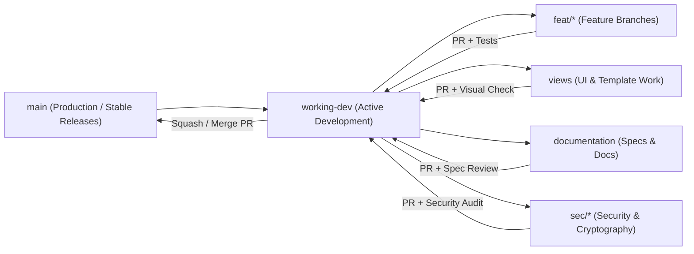

# Sonderring — Version Control, Release Governance & Living Changelog

This living document defines the version control architecture, Git workflow, branching model, database migration discipline, secret protection rules, and release history (`Changelog`) for the **Sonderring** platform.

---

## 1. Repository Status & Git Workflow

> **Current Repository Architecture**: The active Git repository is centered at **`Sonderringv0/`** (connected to remote `origin` on GitHub). The repository tracks all application source code, unit tests, PostgreSQL migrations, and the canonical living documentation suite (`Sonderringv0/docs/`).
> For developer convenience across IDEs, the root workspace `/Users/leilagleich/Desktop/Sonderring/docs` is linked directly to `Sonderringv0/docs/` to guarantee zero documentation drift.

### 1.1 Git Tracking & Remotes
```bash
# Verify active branch and remotes
git status -s -b
git remote -v
```

### 1.2 Mandatory `.gitignore` Specification
Because Sonderring handles **AES-256-GCM encrypted confirmation codes**, **Vault travel attachments**, and local Python virtual environments (`venv/`), `.gitignore` **must** exclude the following paths prior to any commit:

```gitignore
# Python & Virtual Environments
venv/
.venv/
agenv/
__pycache__/
*.py[cod]
*$py.class
*.so

# Environment Variables & Cryptographic Keys (CRITICAL: NEVER COMMIT)
.env
.env.*
!.env.example
*.pem
*.key
*recovery-codes*.txt

# User-Uploaded Vault Media & Local Databases
media/
*.sqlite3
*.sql.gz
*.dump

# OS & Editor Artifacts
.DS_Store
.AppleDouble
.LSOverride
.vscode/
.idea/
*.swp
```

---

## 2. Branching Strategy

Sonderring follows a disciplined **GitHub Flow / Scoped Branching Model** optimized for rapid iteration while safeguarding database integrity and cryptographic security:



### 2.1 Active Branches
* **`main`**: Production-ready code, verified seed datasets, and stable documentation.
* **`working-dev`**: Primary integration branch for multi-feature workflows and schema evolutions.
* **`views`**: Frontend templates, CSS layout, modal interactions, and card template refactors.
* **`documentation`**: Architectural specifications, PRD updates, and living user stories.

### 2.2 Branch Protection Rules for `main`
1. **No Direct Force Pushes**: `git push --force` to `main` is strictly prohibited.
2. **Migration Consistency**: Every pull request modifying `core/models.py` must include the generated Django migration file (`core/migrations/00XX_*.py`) and pass `python manage.py makemigrations --check --dry-run`.
3. **Living Docs Synchronization**: Any PR that alters a database table, role permission, or user workflow must update the corresponding specification in [`docs/`](README.md) in the same pull request.

---

## 3. Commit Message Convention

Sonderring uses the **Conventional Commits** specification:

```text
<type>(<scope>): <concise summary in imperative mood>

[optional body explaining 'why' rather than 'what']
[optional footer: Refs US-MOVE-01, TASK-006]
```

### 3.1 Allowed Types
* `feat`: A new user-facing feature, dimension capability, or security protection.
* `fix`: A bug fix or permission correction.
* `db`: Database schema evolution, migration, index addition, or constraint enforcement.
* `sec`: Cybersecurity, AES-256-GCM encryption, OAuth, or RBAC enforcement changes.
* `docs`: Updates to the living documentation suite in `docs/` or `README.md`.
* `style`: CSS/UI styling, layout refinements, or template formatting.
* `refactor`: Code restructuring that neither fixes a bug nor adds a feature.
* `test`: Adding or updating automated unit and integration tests.
* `chore`: Maintenance tasks, dependency updates, or seed data fixture synchronization.

### 3.2 Canonical Sonderring Scopes
* `auth` — Login, session switching, Google OAuth, user profiles (`UserProfile`, `OAuthIdentity`)
* `trip` — TripSpaces, hybrid dates, trip-level settings (`Trip`)
* `members` — Trippers, invitations, role permissions (`TripMember`)
* `move` — Transit legs, arrival confidence, transport modes (`Move`)
* `stay` — Accommodations, capacities, encrypted confirmation codes (`Stay`)
* `taste` — Dining, restaurants, bars, reservations (`Taste`)
* `play` — Activities, sightseeing, tours, events (`Play`)
* `vault` — Encrypted document attachments & booking links (`Attachment`)
* `sync` — Bidirectional DB-to-Markdown synchronization (`md_sync.py`)
* `audit` — Cryptographic tamper-evident audit logging (`SecurityAuditLog`)

---

## 4. Database Schema & Migration Governance

Because Sonderring relies on a relational PostgreSQL backend with encrypted fields and strict ownership vs. membership links, database changes require strict sequential migrations:

### 4.1 Immutable Migration History
Once a migration in `core/migrations/` has been merged to `working-dev` or `main`, **never edit or delete that migration file**. Always generate a new sequential migration:

| Migration File | Version | Summary of Relational Changes |
| :--- | :---: | :--- |
| `0001_initial.py` | `v0.2.0` | Initial PostgreSQL schema: `User`, `Trip`, `TripMember`, `Stay`, `Nav`, `Do`, `Rec`, `Attachment`. |
| `0002_rec_remove_attachment_chk...` | `v0.3.0` | Added `Rec` model, expanded `Stay` capacity fields, and relaxed attachment targets. |
| `0003_attachment_updated_at...` | `v0.4.0` | Added `updated_by` (`FK -> User`) and `updated_at` across all models for author sovereignty. |
| `0004_userprofile_is_active...` | `v0.5.0` | Decoupled user auth, `is_active`, `last_login`, and password hashing support. |
| `0005_rec_status_rec_idx...` | `v0.5.1` | Added status field and indexing to `Rec`. |
| `0006_trip_status_trip_idx...` | `v0.5.2` | Added status field (`IDEA`, `ACTIVE`, `PAST`, `ARCHIVED`) to `Trip`. |
| `0007_alter_nav_flexibility_notes...` | `v0.5.3` | Cleaned up field lengths and flexibility notes on `Nav`. |
| `0008_securityauditlog.py` | `v0.5.4` | Introduced `SecurityAuditLog` for sensitive credential access tracking. |
| `0009_alter_do_status...` | `v0.5.5` | Aligned status choices across all item models. |
| `0010_rec_guest_name_trip_rec_token...` | `v0.5.6` | Public recommendation link tokens (`rec_token`) and guest attribution. |
| `0011_stay_has_check_in_time...` | `v0.6.0` | Support for optional check-in / check-out times on `Stay`. |
| `0012_alter_attachment_do...` | `v0.6.1` | Expanded attachment foreign keys to support modern dimension models. |
| `0013_taste_price_range.py` | `v0.6.2` | Added `price_range` (`$`, `$$`, `$$$`, `$$$$`) to `Taste`. |
| `0014_alter_taste_taste_type.py` | `v0.6.3` | Refined category taxonomy for dining. |
| `0015_taste_general_link...` | `v0.6.4` | Added `menu_link` and `general_link` to `Taste`. |
| `0016_move_company_play_price_tier...` | `v0.6.5` | Standardized transport company and activity price tiers. |
| `0017_archive_legacy_nav_do_rec.py` | **`v0.7.0`** | **Major Refactor**: Formally dropped legacy `navs`, `dos`, and `recs` tables in favor of `Move`, `Taste`, and `Play`. |
| `0018_add_data_integrity_check...` | `v0.7.1` | Added PostgreSQL check constraints (`chk_stay_dates`, `chk_move_times`, etc.). |
| `0019_create_itinerary_items_view.py` | `v0.7.2` | Created unified PostgreSQL SQL view `v_itinerary_items` for timeline performance. |
| `0020_enforce_database_level_cascades.py`| `v0.7.3` | Enforced raw database-level `ON DELETE CASCADE` and `SET NULL` foreign keys. |
| `0021_security_audit_log_unique_hash...` | **`v0.8.0`** | Cryptographic SHA-256 hash chaining (`previous_hash`, `record_hash`) for audit log tamper-evidence. |

---

## 5. Secret, Encryption Key & Vault Governance

1. **Zero Plaintext Secrets in Git**:
   * `CONFIRMATION_ENCRYPTION_KEY` (used by [`core/encryption.py`](../core/encryption.py) for AES-256-GCM encryption of `Stay.confirmation_code_encrypted` and `Move.confirmation_code_encrypted`) must be loaded from environment variables in production and **never** hardcoded in committed files.
2. **Encryption Key Versioning**:
   * If `CONFIRMATION_ENCRYPTION_KEY` is rotated, a management command must decrypt existing ciphertexts with the previous key and re-encrypt with the new key inside an atomic database transaction before retiring the old key.
3. **Seeded Data Only in Repo**:
   * Canonical seed markdown files in [`docs/seed-trips/`](seed-trips/) and fixtures in [`core/fixtures/seed_data.json`](../core/fixtures/seed_data.json) must only contain synthetic placeholder booking codes (e.g., `BLUE-IS-9941`, `VY-NO-7712`, `DL-2661`) and never real active passenger tickets or personal credentials.

---

## 6. Living Documentation Synchronization Policy

Every change category maps to a designated source-of-truth document in [`docs/`](README.md):

| Change Category | Required Living Document Update |
| :--- | :--- |
| Product vision, pillars, or functional scope | [`docs/PRD.md`](PRD.md) |
| User journeys, acceptance criteria & traceability | [`docs/livingUserStoriesAndAcceptanceCriteria.md`](livingUserStoriesAndAcceptanceCriteria.md) |
| Relational models, columns, SQL views, or ERD | [`docs/DATA_MODEL.md`](DATA_MODEL.md) |
| UI views, workspace tabs, modal forms & responsive UX | [`docs/PAGE_OUTLINE.md`](PAGE_OUTLINE.md) |
| Cryptography, Vault security, RBAC & audit logging | [`docs/CYBERSECURITY.md`](CYBERSECURITY.md) |
| REST API endpoints, parameters, and error codes | [`docs/API_SPECIFICATION.md`](API_SPECIFICATION.md) |
| Markdown sync grammar and seed trip files | [`docs/MARKDOWN_SYNC_SPEC.md`](MARKDOWN_SYNC_SPEC.md) & [`docs/seed-trips/`](seed-trips/) |
| Item fields, form inputs, and dimensional attributes | [`docs/tripItemAttributesReference.md`](tripItemAttributesReference.md) |
| Active sprint tasks & engineering backlog | [`docs/TASKS.md`](TASKS.md) |
| Release notes, migrations & Git policy | [`docs/version-control.md`](version-control.md) (this document) |

---

## 7. Semantic Versioning (`SemVer`) & Living Changelog

Sonderring follows **Semantic Versioning (`MAJOR.MINOR.PATCH`)**:
* **MAJOR (`1.x.x`)**: Production release with stable multi-tenant cloud infrastructure.
* **MINOR (`0.x.0`)**: Significant architectural iterations, dimension additions, or schema evolutions.
* **PATCH (`0.8.x`)**: Bug fixes, template refinements, and documentation clarifications.

### 📜 Release History & Changelog

#### **`v0.8.0` — Tamper-Evident Audit Chaining & Card Template Refactoring (Current)**
* **Security & Auditability (`Migration 0021`)**:
  * Implemented SHA-256 cryptographic hash chaining on [`SecurityAuditLog`](../core/models.py): each entry calculates its `record_hash` using its attributes and the `previous_hash` of the prior log entry, guaranteeing tamper-evidence and preventing silent deletion or tampering.
  * Added concurrency locking to ensure strict chronological serialization of audit log entries.
* **UI & Frontend Refactor**:
  * Decomposed monolithic workspace card rendering into modular template partials for each dimension (`stay_card.html`, `move_card.html`, `taste_card.html`, `play_card.html`).
  * Unified status toggle interactions with interactive status pills, deprecating cyclic arrow buttons.

#### **`v0.7.0` — Move/Taste/Play Domain Refactor & Database Integrity (`Migrations 0017–0020`)**
* **Database & Core Architecture**:
  * Completed the transition to the four core travel dimensions: dropped legacy `navs`, `dos`, and `recs` tables in migration `0017`.
  * Created `v_itinerary_items` unified database view (`Migration 0019`) to power the chronological timeline view without multiple expensive union joins.
  * Added database-level check constraints (`Migration 0018`) ensuring check-out dates are never earlier than check-in dates and arrival times follow departure times.
  * Enforced database-level cascading deletes (`Migration 0020`) for clean referential integrity.

#### **`v0.6.0` — Flexible Time Attributes & Dimension Enrichment (`Migrations 0011–0016`)**
* **Time Flexibility**:
  * Added optional check-in and check-out time tracking for `Stay` (`has_check_in_time`, `has_check_out_time`).
  * Enriched `Taste` with price tiers (`$`, `$$`, `$$$`, `$$$$`), `menu_link`, and `general_link`.
  * Added transport operating company to `Move` and activity price tiers to `Play`.

#### **`v0.5.0` — Google OAuth Social Login & Public Recommendation Tokens (`Migrations 0004–0010`)**
* **Authentication & Collaboration**:
  * Implemented decoupled Google OAuth 2.0 social login via [`OAuthIdentity`](../core/models.py).
  * Introduced public recommendation link tokens (`rec_token` on `Trip`), allowing friends and family to recommend spots without registering for an account (`templates/public_recommend.html`).

#### **`v0.4.0` — Attribution Traceability & Universal Author Sovereignty (`Migration 0003`)**
* Added `updated_by` (`FK -> UserProfile`) and `updated_at` across all items.
* Enforced **Universal Author Sovereignty**: every trip member can edit or delete items they personally authored regardless of their assigned trip role.

#### **`v0.3.0` — Full CRUD Workspace & Form-Based Intake Expansion (`Migration 0002`)**
* Built full CRUD endpoints for all workspace tabs, profile management view, and persona switcher.

#### **`v0.2.0` — Django + PostgreSQL Relational MVP & AES-256-GCM Vault (`Migration 0001`)**
* Transitioned from wireframes to Django 4.2 + PostgreSQL with application-level AES-256-GCM encryption for confirmation codes.
